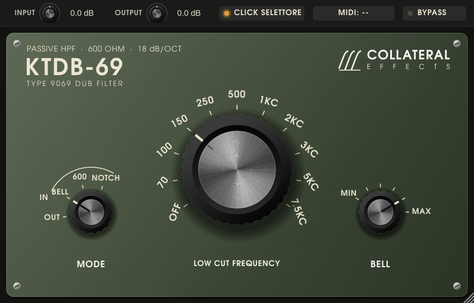
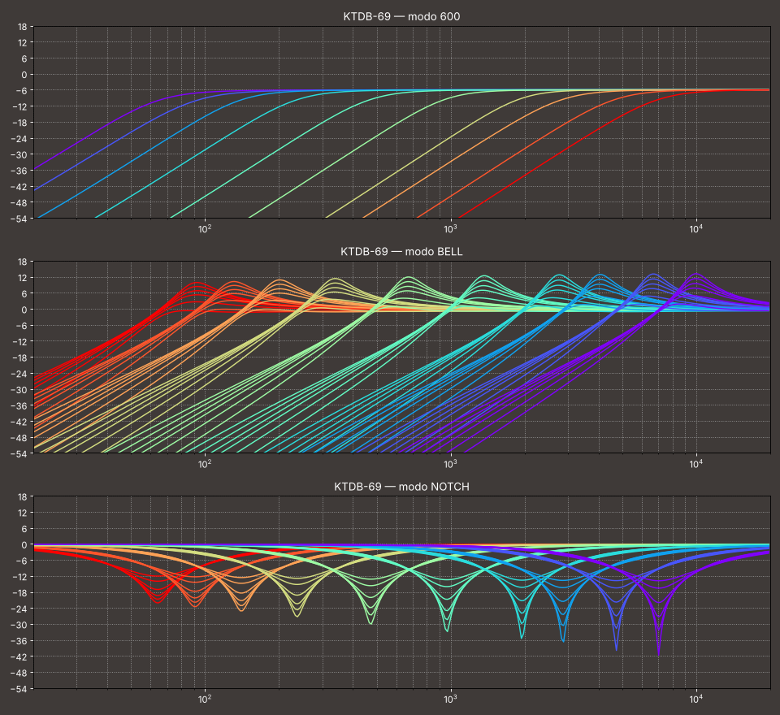

# KTDB-69 (Collateral Effects) — emulazione del filtro passa-alto passivo Altec 9069B (VST3 / AU / Standalone)

Plugin in C++17 con JUCE 8. Riproduce il "Big Knob" di King Tubby: il filtro passa-alto passivo
Altec 9069B (rete LC da 600 Ω, 18 dB/ottava, 10 frequenze da 70 Hz a 7.5 kHz più OFF), con i tre
modi del KTBK-1B di Audio Merge, che ha fornito le curve di riferimento.



Manuale d'uso: [docs/Manuale-KTDB-69.pdf](docs/Manuale-KTDB-69.pdf) (incluso anche nello zip per Mac).

## Grafica

Pannello verde oliva, font TeX Gyre Adventor (stile Avant Garde, incorporato nel plugin) e logo
Collateral Effects con tre curve passa-alto: tre scatti della manopola grande. Lo stesso logo è l'icona
dell'app Standalone. "TYPE 9069 DUB FILTER" è spaziato per occupare esattamente la larghezza di
"KTDB-69", e "EFFECTS" quella di "COLLATERAL": la spaziatura si calcola sui contorni reali delle lettere
(`ui::drawJustified` in `Source/Theme.h`).

Il font è distribuito con la GUST Font License (`resources/fonts/GUST-FONT-LICENSE.txt`), che ne
consente l'incorporamento. L'icona si rigenera con `gui_snapshot resources/icon.png`.

## Comandi

Gli stessi del pannello hardware:

| Comando | Posizioni | CC predefinito |
|---|---|---|
| **Manopola grande** (LOW CUT FREQUENCY) | OFF, 70, 100, 150, 250, 500, 1KC, 2KC, 3KC, 5KC, 7.5KC | 20 |
| **BELL** | 6 livelli, MIN … MAX (DF0 … DF5) | 21 |
| **MODE** | OUT (true bypass), BELL, 600, NOTCH | 22 |
| **BYPASS** (barra superiore: confronto con e senza filtro) | acceso / spento | 64 (pedale sustain) |
| Pulsante **IN/OUT** (commuta tra OUT e l'ultimo modo usato) | — | — |
| INPUT / OUTPUT (barra superiore, ±24 dB) | — | — |
| MIX (barra superiore: filtrato + diretto, effetto phasing) | 0–100 % | — |
| CLICK (barra superiore: rimbalzi del selettore) | acceso / spento | — |

BYPASS è un true bypass con latenza compensata ed è anche il bypass che la DAW vede per il plugin.

- **600** — la risposta originale del 9069B: sorgente e carico da 600 Ω, Butterworth del 3° ordine
  con 6 dB di perdita di inserzione (come l'originale: alza OUTPUT se serve).
- **BELL** — il suono di King Tubby: la rete pilotata dall'uscita a bassa impedenza del banco e
  caricata da un ingresso "a ponte" non è terminata e risuona. Il picco cade a circa 1.37 volte la
  frequenza indicata e arriva a +10 dB (70 Hz) … +13 dB (7.5 kHz) con BELL al massimo; MIN non ha picco.
  Nessuna perdita di inserzione.
- **NOTCH** — gli stessi componenti ricollegati come ramo LC serie verso massa: reiezione centrata
  sulla frequenza della manopola, da −22 dB (70 Hz) a −42 dB (7.5 kHz) con BELL al massimo; il livello
  BELL riduce la profondità. (Questo modo è un'aggiunta del KTBK-1B, non esiste sul 9069B.)
- **OUT** — true bypass, latenza compensata.

**Click del selettore** (acceso di serie): come un vero commutatore rotativo, a ogni scatto il
contatto si apre, rimbalza qualche volta e i nuovi componenti entrano nel circuito scarichi: nascono
click, piccoli "crunch" e transitori reali, che in BELL suonano come il tipico "colpo" risonante
delle sweep dub. Spento, il
passaggio tra le posizioni è una dissolvenza di 25 ms.

Uso con il mouse: trascina in verticale (o in orizzontale), usa la rotella, oppure clicca
direttamente su una scritta della scala per saltare a quella posizione.

## Tastiera MIDI (Arturia KeyLab)

**Il plugin legge la tastiera direttamente**: apre da solo le porte MIDI del Mac, quindi i comandi
della KeyLab funzionano anche con il plugin su una traccia audio, senza tracce MIDI né instradamenti,
in Live come in Logic. Il pulsante **MIDI** nella barra superiore sceglie la porta:

- *Tutti gli ingressi MIDI* (predefinito);
- una porta precisa (es. "KeyLab mkII 61 MIDI"): utile se usi più istanze del plugin e vuoi che
  rispondano a tastiere diverse;
- *Nessuno*: solo il MIDI instradato dalla DAW (come un normale plugin).

Il pulsante lampeggia a ogni CC ricevuto; il suo menu mostra le assegnazioni e l'ultimo CC arrivato.
Con l'ingresso diretto attivo i CC che arrivano anche dalla DAW sono ignorati, così un pulsante non
viene commutato due volte. Nella versione Standalone la porta si sceglie in *Options → Audio/MIDI Settings*.

**MIDI Learn**: clic destro su un comando → *MIDI Learn* → muovi un encoder, un fader o un pulsante
della KeyLab. Il pulsante MIDI mostra "LEARN: …" finché non arriva un CC. La mappatura è salvata nel
progetto. Il pulsante IN/OUT si assegna dal menu del clic destro sulla manopola MODE. I comandi a
scatti hanno un'isteresi: un fader fermo a cavallo tra due posizioni non fa "tremolare" il selettore.

- La KeyLab deve mandare **CC**: usa la modalità *User* (o *Arturia/Analog Lab*), non la modalità
  *DAW*, che sulla porta "DAW" trasmette comandi Mackie/HUI e non CC.
- Gli encoder vanno in modalità *Absolute* (0–127) in Arturia MIDI Control Center.
- I pulsanti (BYPASS, IN/OUT, CLICK) commutano alla pressione: imposta il pulsante in modalità
  *Gate/Momentary*.
- In alternativa puoi sempre usare la mappatura MIDI della DAW sui parametri del plugin
  (Live: Cmd+M; Logic: Cmd+K).

## Scaricare la versione per Mac (Apple Silicon e Intel)

Ogni modifica su `main` viene compilata da GitHub Actions su macOS (universal binary: M1–M4 e Intel),
con i test del modello e la validazione `auval` dell'Audio Unit.

1. Nel repository apri **Actions → Build macOS**, scegli l'ultima esecuzione riuscita e scarica
   l'artefatto **KTDB69-macOS**. Per una versione "ufficiale" crea un tag `v1.0.0`: la build compare
   anche in **Releases**, scaricabile senza login.
2. Estrai lo zip (contiene a sua volta `KTDB69-macOS.zip`, estrai anche quello).
3. Il plugin non è firmato con un certificato Apple Developer: apri il Terminale e trascina dentro la
   cartella `KTDB-69` dopo questo comando:
   ```
   xattr -dr com.apple.quarantine 
   ```
   poi fai doppio clic su **Installa KTDB-69.command** (copia VST3 e AU nelle cartelle dei plugin
   dell'utente e l'app Standalone in Applicazioni).
4. Riavvia la DAW (in Logic: se non compare, *Plug-in Manager → Reimposta e riscansiona*).

## Il modello



Rete a T "costante-K" da 600 Ω con induttore toroidale a prese (la topologia descritta sia da
Audio Merge sia da AudioThing per il 9069B):

```
Vin ─ Rs ─ A ──||── B ──||── C ─┬─ uscita       C1 = C2 = kC / (2π·fc·600)
               C1    │    C2    RL              L = kL · 600 / (4π·fc)
                     L (+r)     │
                     ⏚          ⏚
```

| Modo | Rs | RL |
|---|---|---|
| 600 | 600 Ω | 600 Ω |
| BELL | 40 Ω | 512 / 845 / 1311 / 1754 / 2493 / 3744 Ω (MIN … MAX) |
| NOTCH | 600 Ω | 20 kΩ, ramo (C1‖C2) + L con 150 / 100 / 47 / 22 / 10 / 0 Ω in serie |

- Con 600 Ω da entrambi i lati la rete è una Butterworth del 3° ordine (g = 1, 2, 1):
  −9 dB alla frequenza indicata, −6 dB in banda passante, 18 dB/ottava.
- Gli induttori sono le prese di un toroide: resistenza dell'avvolgimento r = 51 Ω·√(70/fc). Con
  questo solo dato le profondità del NOTCH previste coincidono con quelle misurate su tutti e dieci gli
  scatti entro 0.6 dB (da −22.5 dB a 70 Hz a −41.3 dB a 7.5 kHz).
- **Tolleranze dei componenti, scatto per scatto.** Dalle curve misurate dell'unità di riferimento
  (grafici Audio Merge, digitalizzati) si leggono per ogni scatto tre frequenze indipendenti: il taglio
  in 600, il picco BELL e il minimo NOTCH. Due soli fattori per scatto (kL per l'induttore, kC per i
  condensatori) le riproducono tutte e tre entro lo 0.5 % tra 70 Hz e 3 kHz:

  | Scatto | 70 | 100 | 150 | 250 | 500 | 1K | 2K | 3K | 5K | 7.5K |
  |---|---|---|---|---|---|---|---|---|---|---|
  | kL | 1.14 | 1.07 | 1.10 | 1.05 | 1.03 | 1.04 | 1.05 | 0.97 | 0.99 | 0.97 |
  | kC | 1.05 | 1.13 | 1.03 | 1.06 | 1.08 | 1.04 | 1.00 | 1.14 | 1.14 | 1.18 |
  | picco BELL / fc | 1.32 | 1.31 | 1.34 | 1.35 | 1.35 | 1.37 | 1.38 | 1.35 | 1.33 | 1.31 |

  Sono scostamenti tipici di componenti degli anni '60 e danno a ogni scatto il suo carattere, invece
  di una serie di filtri tutti uguali e solo traslati.
- I sei livelli BELL sono tarati sulle sei curve misurate (circa +1 / +4 / +7 / +8.6 / +10.4 / +12 dB
  a 1 kHz; il massimo sale da +10 dB a 70 Hz a +13 dB a 7.5 kHz per effetto delle perdite dell'induttore).
- Il nucleo satura dolcemente (i = φ/L·(1+(φ/φs)²)): a livello di linea è trasparente (0.005 % a
  +4 dBu in 600), si sente spingendo INPUT sui passi bassi, soprattutto in BELL. 0 dBFS = +18 dBu.
- **Selettore**: con CLICK acceso il contatto si apre per 0.6–1.6 ms e poi rimbalza 1–3 volte prima di
  chiudersi, mentre i componenti del nuovo scatto entrano scarichi: sono i "click e crunch" del banco
  di Tubby descritti nelle fonti. La sequenza cambia a ogni scatto, ed è la stessa sui due canali.
- **MIX** (barra superiore): somma filtrato e diretto come si faceva sul banco, da cui l'effetto
  phasing citato nelle descrizioni del suono di Tubby. Il diretto attraversa un oversampler gemello
  senza la rete, quindi la somma è perfettamente in fase (scarto 0.000 dB da 20 Hz a 20 kHz): il
  phasing che si sente è solo quello del filtro. OUTPUT agisce sul percorso filtrato.
- **BYPASS** è il segnale originale ritardato esattamente della latenza dichiarata (6 campioni a
  44.1/48 kHz). Dopo 150 ms di bypass la rete smette di essere calcolata (CPU quasi nulla) e quando
  torna in circuito riparte scarica, come una rete appena ricollegata.
- Risoluzione: analisi nodale a 3 nodi con la regola dei trapezi pre-deformata (prewarping) sulla
  risonanza dello scatto; la non linearità dell'induttore è risolta con Newton su una sola variabile
  (equivalente di Thevenin), saltato quando il nucleo è lontano dalla saturazione. La rete gira sempre
  a 176–192 kHz (oversampling 4× a 44.1/48 kHz, 2× a 88.2/96 kHz): errore massimo rispetto alla
  risposta teorica 0.27 dB fino a 14 kHz, 0.06 dB sui picchi BELL. Circa 3 % di un core per un'istanza
  stereo a 48 kHz.
- Interfaccia: sfondo e parti fisse delle manopole sono tenuti in cache alla risoluzione dello schermo
  (disegno completo circa 3.5 volte più veloce su Retina); con zoom non intero si disegna direttamente.

Tutti i valori sono in `struct Design` dentro `Source/AltecNetwork.h`.

**Limiti noti**: lo schema interno del 9069B non è pubblicato. La topologia è quella indicata dalle
fonti (rete a T con induttori toroidali) e la taratura viene dalle curve del KTBK-1B, che dichiara di
essere validato sull'originale: le tolleranze descrivono quindi l'unità misurata, non ogni 9069B. La saturazione del nucleo è un'ipotesi ragionevole, non una misura. Il modo
NOTCH riproduce il comportamento descritto da Audio Merge, non un circuito documentato.

## Compilazione

Serve CMake ≥ 3.22. JUCE 8.0.4 viene scaricato automaticamente (oppure `-DJUCE_DIR=/percorso/JUCE`).

**macOS (VST3 + AU, universal binary)** — con Xcode installato:
```
cmake -B build -G Xcode
cmake --build build --config Release
```
**Windows (VST3)** — con Visual Studio 2022:
```
cmake -B build -G "Visual Studio 17 2022"
cmake --build build --config Release
```

Test: `network_test` (simulazione contro la risposta teorica, picchi e notch, distorsione, click, CPU).
Con `-DDB69_BUILD_SNAPSHOT=ON` si compilano anche `processor_test` (CC MIDI, livelli, bypass, stato)
e `gui_snapshot` (salva l'interfaccia in PNG).
